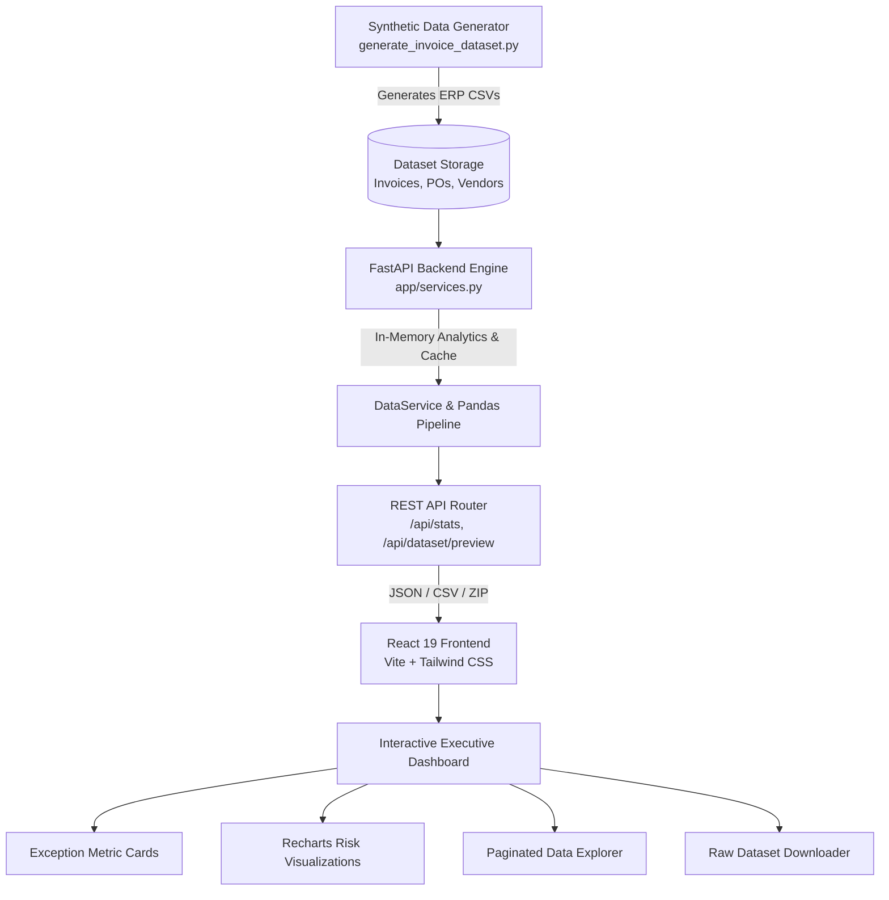

# ERP Invoice Exception Detection & Anomaly Intelligence Platform

[](https://www.python.org/)
[](https://fastapi.tiangolo.com/)
[](https://react.dev/)
[](https://vitejs.dev/)
[](https://tailwindcss.com/)
[](https://recharts.org/)
[](LICENSE)

An enterprise-grade, full-stack intelligence system designed to simulate, detect, audit, and analyze anomalies in Accounts Payable (AP) and Enterprise Resource Planning (ERP) invoice pipelines. 

Built with **FastAPI**, **Pandas**, **React 19**, and **Tailwind CSS**, this platform automates automated 3-way match validation to protect organizations against duplicate payments, price mismatches, maverick spending, and Business Email Compromise (BEC) banking fraud.

---

## 📌 Executive Summary & Motivation

In modern enterprise ERP ecosystems (SAP, Oracle, NetSuite), finance teams process tens of thousands of invoices monthly. While standard 3-way matching (matching Purchase Orders, Goods Receipts, and Vendor Invoices) exists in principle, high volume and siloed data create dangerous operational blindspots:
- **Duplicate Billings:** Identical invoices paid across differing fiscal cycles or business units.
- **Price & Quantity Inflation:** Hidden price creep and unauthorized quantity alterations exceeding contracted tolerances.
- **Bank Detail Tampering:** Malicious changes to vendor routing and IBAN accounts without dual approval.
- **Maverick Spend:** Off-contract procurement bypassing pre-approved Purchase Orders.

This project delivers:
1. A **reproducible synthetic ERP dataset engine** simulating real-world procurement data with statistically realistic anomaly distributions.
2. A high-performance **FastAPI backend** providing in-memory analytical aggregation, dynamic filtering, sorting, and live reporting.
3. An interactive, modern **React executive dashboard** featuring visual analytics, risk profiling, drill-down data explorer, and data export facilities.

---

## 🏗️ System Architecture



---

## ✨ Key Features

- **Enterprise Exception Modeling:** 5 distinct real-world anomaly classes injected with realistic distribution weights.
- **Blazing Fast Analytics:** Sub-millisecond aggregation and filtering across 20,000+ invoice records using vectorized Pandas queries.
- **Dynamic Executive Dashboard:** Interactive charts showing monthly exception trends, anomaly type distributions, and high-risk vendor rankings.
- **Full-Featured Data Explorer:**
  - Real-time multi-field search (Invoice ID, PO Reference, Vendor Name).
  - Multi-criteria filtering by exception type, vendor, and custom date intervals.
  - Server-side sorting, pagination, and status badges.
- **Dataset Export & Bundling:** Instant on-the-fly streaming of filtered datasets as CSV or packaged ZIP bundles.
- **RESTful API Documentation:** Built-in OpenAPI (Swagger UI) documentation for easy integration testing.

---

## 🎯 Exception Taxonomy & Detection Rules

| Exception Type | Distribution Weight | Real-World Scenario | Detection & Auditing Rule |
|---|:---:|---|---|
| **Amount & Quantity Mismatch** | **30%** | Vendor bills more than authorized PO value or unit count. | `invoice.total_amount > po.total_amount * (1 + tolerance)` |
| **Duplicate Invoices** | **25%** | Same invoice re-submitted across branches or fiscal periods. | Identical `(vendor_id, invoice_number, total_amount)` match. |
| **Missing / Invalid PO** | **20%** | Maverick spend or invoices bypassing approved purchase requisitions. | `invoice.po_reference` not found or marked closed in ERP master. |
| **Vendor Bank Account Discrepancy** | **15%** | Account takeover or spoofed routing details (BEC fraud). | `invoice.remit_to_iban != vendor_master.iban` |
| **Date & Term Inversions** | **10%** | Invoice dates preceding PO issuance or defying Net 30/60/90 terms. | `invoice.invoice_date < po.po_date` or due date calculations anomalous. |

---

## 🛠️ Tech Stack

### Backend
- **Python 3.11+**
- **FastAPI**: Modern, asynchronous web framework for building APIs.
- **Uvicorn**: Lightning-fast ASGI server implementation.
- **Pandas & NumPy**: High-performance vectorized dataset querying and aggregation.
- **Pydantic v2**: Strict request/response validation and typing.
- **Faker**: Reproducible enterprise synthetic data generation.

### Frontend
- **React 19**: Component-based UI architecture.
- **Vite 8**: Next-generation frontend build tooling with hot module replacement.
- **Tailwind CSS 4**: Modern utility-first styling system.
- **Recharts**: Composable charting library built on React components.
- **Lucide React**: Clean, accessible enterprise iconography.

---

## 📂 Project Directory Structure

```plaintext
PROJECT 1/
│
├── DATASETS/
│   ├── generate_invoice_dataset.py      # Synthetic ERP dataset generator CLI
│   ├── invoices.csv                     # 20,000 generated invoice records
│   ├── purchase_orders.csv              # 16,500 PO records
│   └── vendors.csv                      # Master vendor registry
│
├── backend/
│   ├── app/
│   │   ├── __init__.py
│   │   ├── config.py                    # Path resolution & environment settings
│   │   ├── main.py                      # FastAPI application bootstrap & CORS
│   │   ├── routes.py                    # REST API route handlers
│   │   ├── schemas.py                   # Pydantic data models & DTOs
│   │   └── services.py                  # In-memory Pandas analytics & cache
│   ├── data/                            # Active dataset directory
│   └── requirements.txt                 # Backend Python dependencies
│
├── frontend/
│   ├── public/                          # Static assets and icons
│   ├── src/
│   │   ├── assets/                      # Graphic assets
│   │   ├── components/
│   │   │   ├── DataExplorer.jsx         # Interactive invoice search & filter table
│   │   │   ├── DownloadSection.jsx      # Dataset export actions
│   │   │   ├── Footer.jsx               # Application footer
│   │   │   ├── Hero.jsx                 # Executive landing hero banner
│   │   │   ├── Navbar.jsx               # Navigation bar
│   │   │   ├── ProblemStatement.jsx     # Exception cards & ERP context breakdown
│   │   │   └── StatsSection.jsx         # Recharts anomaly analytics & KPI cards
│   │   ├── api.js                       # Frontend HTTP client service
│   │   ├── App.jsx                      # Main application view assembly
│   │   ├── index.css                    # Tailwind CSS imports & theme rules
│   │   └── main.jsx                     # React root mount
│   ├── index.html                       # HTML5 entry point
│   ├── package.json                     # Node.js dependencies and scripts
│   └── vite.config.js                   # Vite configuration
│
├── .gitignore                           # Git exclusion rules
├── LICENSE                              # MIT License
└── README.md                            # Project documentation
```

---

## 🚀 Quickstart & Local Setup

### Prerequisites
- **Python**: Version `3.10` or higher
- **Node.js**: Version `18.0` or higher (LTS recommended)
- **Git**: Installed and configured

---

### Step 1: Clone the Repository
```bash
git clone https://github.com/KishoreK-gif/<YOUR-REPO-NAME>.git
cd <YOUR-REPO-NAME>
```

---

### Step 2: Backend Setup (FastAPI)

1. Open a terminal and navigate to the `backend` folder:
   ```bash
   cd backend
   ```

2. Create and activate a Python virtual environment:
   - **Windows:**
     ```powershell
     python -m venv .venv
     .venv\Scripts\Activate.ps1
     ```
   - **macOS / Linux:**
     ```bash
     python3 -m venv .venv
     source .venv/bin/activate
     ```

3. Install dependencies:
   ```bash
   pip install -r requirements.txt
   ```

4. *(Optional)* Regenerate datasets if needed:
   ```bash
   python ../DATASETS/generate_invoice_dataset.py --invoices 20000 --seed 20260914
   ```

5. Launch the FastAPI server:
   ```bash
   uvicorn app.main:app --reload --port 8000
   ```
   *The backend will be live at `http://127.0.0.1:8000`. You can inspect interactive API documentation at `http://127.0.0.1:8000/docs`.*

---

### Step 3: Frontend Setup (React + Vite)

1. Open a new terminal and navigate to the `frontend` folder:
   ```bash
   cd frontend
   ```

2. Install dependencies:
   ```bash
   npm install
   ```

3. Start the development server:
   ```bash
   npm run dev
   ```
   *Open your browser at `http://localhost:5173` to view the platform.*

---

## 📡 REST API Reference

| Method | Endpoint | Description | Query Parameters |
|---|---|---|---|
| `GET` | `/` | API Health & operational status | None |
| `GET` | `/api/stats` | Aggregated anomaly KPIs, monthly trends, and distributions | None |
| `GET` | `/api/dataset/preview` | Paginated, filtered, and sorted invoice table records | `page`, `page_size`, `sort_by`, `sort_order`, `exception_type`, `vendor_id`, `date_from`, `date_to`, `search` |
| `GET` | `/api/dataset/download` | Download raw CSV datasets or generated ZIP archive | `file` (`all`, `invoices`, `purchase_orders`, `vendors`) |

---

## 📊 Data Dictionary

| Column Name | Data Type | Description |
|---|---|---|
| `invoice_id` | String | Unique human-readable invoice identifier (`INV-XXXXXXXX`) |
| `vendor_id` | String | Unique vendor identifier (`VEND-XXXXXXXX`) |
| `vendor_name` | String | Commercial entity registered in vendor master |
| `po_reference` | String | Associated purchase order number (`PO-XXXXXXXX`) |
| `invoice_date` | Date | Invoice issuance timestamp (`YYYY-MM-DD`) |
| `due_date` | Date | Payment maturity date based on contractual payment terms |
| `total_amount` | Float | Gross billed invoice sum in USD |
| `currency` | String | Transaction currency code (`USD`) |
| `payment_terms` | String | Contractual terms (`Net 30`, `Net 60`, `Net 90`) |
| `remit_to_iban` | String | Bank account identifier provided on invoice remittance |
| `is_exception` | Boolean | Ground-truth anomaly indicator flag (`True` / `False`) |
| `exception_type` | String | Exception category label or `none` for clean records |

---

## 📈 Future Enhancements

- [ ] **Machine Learning Classifier:** Implement an automated XGBoost / LightGBM model to predict anomaly probabilities prior to human audit.
- [ ] **Document OCR Integration:** Add an OCR ingestion pipeline (using Tesseract or AWS Textract) to extract data directly from PDF/Scanned invoices.
- [ ] **Real-time Webhook Alerts:** Integrate Slack/Email notifications for high-risk vendor bank tampering flags.
- [ ] **ERP Connectors:** Build SAP RFC and NetSuite RESTlet sync connectors.

---

## 👤 Author & Contact

**Kishore K**
- GitHub: [@KishoreK-gif](https://github.com/KishoreK-gif)
- Portfolio / LinkedIn: *Available upon request*

---

## 📄 License

This project is licensed under the [MIT License](LICENSE).
